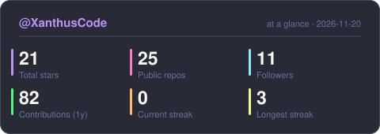
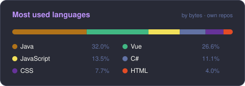

<!-- BANNER — terminal profile.sh --live. Generated by scripts/generate.py from assets/profile.json -->
<picture>
  <source media="(prefers-color-scheme: dark)"  srcset="assets/banner-dark.svg">
  <source media="(prefers-color-scheme: light)" srcset="assets/banner-light.svg">
  
</picture>

 

<!-- NAME / TAGLINE — animated typing -->

 

<!-- SOCIALS -->

---

## 👋 This is me

I'm **Johan**, a self-taught developer from Colombia 🇨🇴, working toward full-stack.

- ☕ I build backends with **Java & Spring Boot** — like [`ecommerce-Backend`](https://github.com/XanthusCode/ecommerce-Backend), a REST API for an online store.
- 🖼️ On the frontend I use **Vue & React** — [`Finanzas_App`](https://github.com/XanthusCode/Finanzas_App) is a personal finance tracker in Vue.
- 🌱 Currently learning **C# / .NET**.
- 🛡️ Interested in **cybersecurity** and open to collaborating on security projects.
- 💬 Ask me about **Java, Spring, web development or learning to code on your own**.

 

## ⚒️ Languages · Frameworks · Tools ⚒️

---

## 📡 signals

<table>
<tr>
<td width="50%" align="center" valign="middle">

<!-- Self-rated radar — edit assets/skills.json, the workflow redraws it -->
<picture>
  <source media="(prefers-color-scheme: dark)"  srcset="assets/radar-dark.svg">
  <source media="(prefers-color-scheme: light)" srcset="assets/radar-light.svg">
  
</picture>

</td>
<td width="50%" align="center" valign="middle">

<!-- Language radar — edit assets/langmix.json -->
<picture>
  <source media="(prefers-color-scheme: dark)"  srcset="assets/radar-langs-dark.svg">
  <source media="(prefers-color-scheme: light)" srcset="assets/radar-langs-light.svg">
  
</picture>

</td>
</tr>
</table>

---

## ⚡ Numbers matter? ohhh yes. ⚡

<!-- Generated into this repo by scripts/generate.py (daily Action) — no shared
     third-party stats instances that go down and take the whole section with them. -->
<picture>
  <source media="(prefers-color-scheme: dark)"  srcset="assets/card-stats-dark.svg">
  <source media="(prefers-color-scheme: light)" srcset="assets/card-stats-light.svg">
  
</picture>
<picture>
  <source media="(prefers-color-scheme: dark)"  srcset="assets/card-langs-dark.svg">
  <source media="(prefers-color-scheme: light)" srcset="assets/card-langs-light.svg">
  
</picture>

---

## 🐍 My Contributions 🐍

<picture>
  <source media="(prefers-color-scheme: dark)"  srcset="assets/snake-dark.svg">
  <source media="(prefers-color-scheme: light)" srcset="assets/snake-light.svg">
  
</picture>

---

` Built with ☕ & curiosity · Colombia 🇨🇴 · @XanthusCode `

